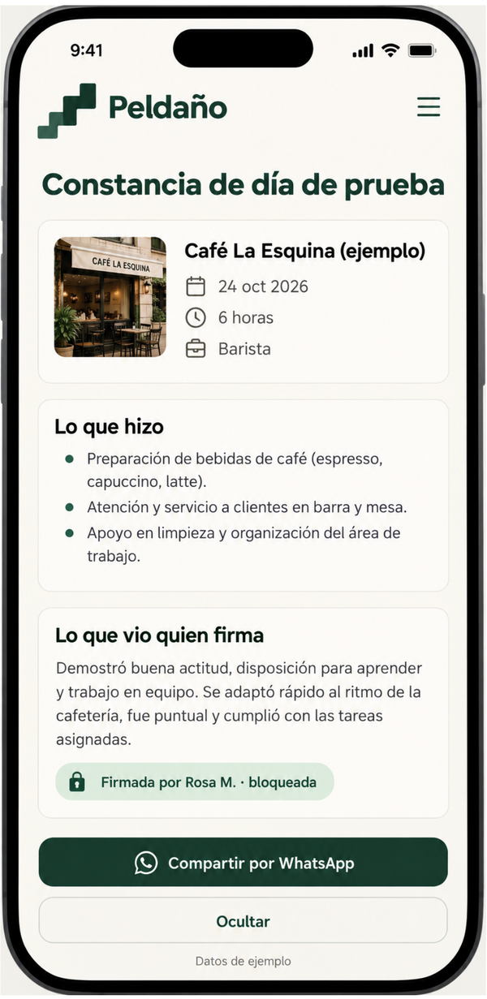
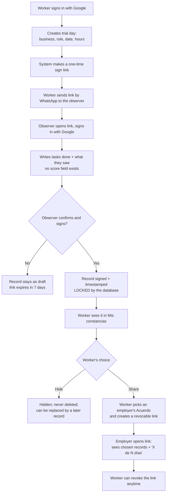
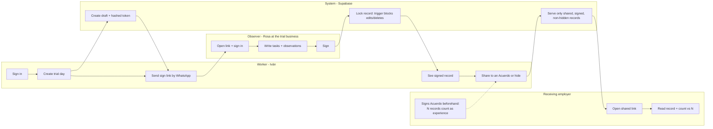

# Peldaño — Week 12 Build Packet

**Founder:** Josep Ferré Gil · Team 7 · **Venture:** Peldaño · **URL of record:** https://peldano.xyz
**Packet v1 · 26 Oct 2026** · Written before any code. Governed by `docs/CHARTER.md`; personas in `docs/PERSONAS.md`.

---

## 1. Problem, in my words

A young worker does a trial day at a small café, restaurant or shop. He works the whole shift — often unpaid — and nobody calls him back. The work was real, but nothing records it, so the next employer still hears "no tienes experiencia" and the worker pays for another trial day. The cost is real and can't be proven, so nobody has to answer for it.

## 2. Exact user

- **Primary:** Iván, 22, Iztapalapa — the worker who absorbs the loss (Persona 1).
- **Secondary:** Rosa, 38, café owner in Narvarte — observes the trial day and signs; as an employer, she can also sign an Acuerdo (Persona 2, hypothesis).

## 3. Success definition

**Before the module closes:** at peldano.xyz, a worker signs in with Google, creates a trial day and sends a sign link by WhatsApp; the observer opens it, signs in, writes what the worker did and signs; the record is **locked in the database** (no edit, no delete, no score); the worker shares it with an employer who signed an Acuerdo, and that employer sees the record and "1 de N días de prueba" — all on the live domain, with invented data.

## 4. Mockup (image-generated)

*Prompt used in the free image generator:*
> Mobile phone screen mockup, clean flat UI, Spanish language, warm off-white background, deep green accent. App name "Peldaño" at top with a small stair-step logo. Title "Constancia de día de prueba". A card showing: business "Café La Esquina (ejemplo)", date "24 oct 2026", "6 horas", role "Barista". Section "Lo que hizo": three bullet lines of tasks. Section "Lo que vio quien firma": a short paragraph. A green badge "Firmada por Rosa M. · bloqueada". No stars, no score. Bottom buttons: "Compartir por WhatsApp" and "Ocultar". Small label at bottom: "Datos de ejemplo".

## 5. The flow — Mermaid

### 5a. Flowchart: how the core feature works

### 5b. Swimlane: who does what

*No AI in this flow. A person writes and signs every record (Method Step 6); the database enforces the lock (Method Step 7).*

## 6. Benchmark line

- **The best existing solution on Earth for this is** Harambee Youth Employment Accelerator (South Africa), which assesses young workseekers and shares detailed results with both the worker and employers — two-sided proof that raised employment and earnings (Carranza, Garlick, Orkin & Rankin).
- **Mine differs/localizes by** recording a trial day that already happens at a small Mexican business instead of a new assessment: the proof is signed by the person who watched real work, owned by the worker on his phone, and addressed to employers who pre-agreed it counts as experience.

## 7. Long view (light charter)

If this slice works, Peldaño becomes the default way small businesses in Mexican cities close a trial day: a two-minute signature that every candidate walks out with. Workers carry a growing, signed history that no platform deactivation can erase, and employers in a network of Acuerdos accept it in place of "experiencia comprobable." That network — not the app — is the asset: the layer that a first-job law banning experience requirements needs in order to actually work.

## 8. Scope cut — NOT building in week 12

- No AI of any kind (no note tidying, no skills inference). Revisit only after the lock works.
- No job listings, matching, scheduling of trial days, or payments.
- No scores, ratings, reviews — the schema has no column for them.
- No editing a signed record; corrections = a new record.
- No email/SMS sending — the worker shares links himself via WhatsApp (`wa.me` link).
- No employer directory: an Acuerdo is found by its link/code only.
- No admin panel, analytics, multiple languages, native app, IMSS integration.
- Venture site: home, /product, /about only — no blog, no pricing page.

## 9. Architecture + stack

| Layer | Choice | Why |
|---|---|---|
| Framework | Next.js (App Router) + React | Course stack; server actions keep secrets server-side |
| Styling | Tailwind CSS | Course stack; mobile-first |
| Auth | Supabase Auth — Sign in with Google | Security Floor: personal data behind auth |
| Database | Supabase Postgres with RLS on every table | Users see only their own rows |
| The lock | Postgres trigger + `security definer` RPCs | Step 7 enforced in the DB, not in the UI |
| Hosting | Vercel, connected to GitHub | 2+ deploys; env vars hold keys |
| Domain | peldano.xyz → Vercel | Venture Rule: URL of record |
| Sharing | `wa.me/?text=` links | No messaging API, no cost |

**Data model**

| Table | Key columns | Rules |
|---|---|---|
| `records` | id, worker_id, business_name, role, trial_date, hours, tasks, observations, observer_id, observer_name, signed_at, hidden, sign_token_hash, token_expires_at | RLS: worker reads own rows. Signing only through RPC `sign_record(token, …)`. Trigger: once `signed_at` is set, content columns can't change; DELETE forbidden for everyone. No score column. Text length limits as CHECK constraints. |
| `acuerdos` | id, employer_id, business_name, n_days (1–10), statement, signed_at, public_code | RLS: employer manages own; public read of name + n_days by code only. Statement always says "no es promesa de contratación". |
| `shares` | id, worker_id, acuerdo_id, token_hash, record_ids, revoked_at | RLS: worker manages own. Employer view only through RPC `get_share(token)`, which returns signed, non-hidden, non-revoked records. |

**Routes:** `/` · `/product` · `/about` (need + who pays + 10:1 case, with the open assumptions stated) · `/app` (Mis constancias) · `/app/nueva` · `/firmar/[token]` · `/acuerdo/nuevo` · `/acuerdo/[code]` · `/ver/[token]`

## 10. Security floor plan

- 🔑 Supabase URL/anon key and service key only in Vercel env vars; `.env*` in `.gitignore`; service key never shipped to the browser.
- 🔐 Google sign-in required for workers, observers and employers.
- 🚪 RLS ON for `records`, `acuerdos`, `shares`; public access only through narrow RPCs.
- 🧹 Validation on every form (zod on the server + DB CHECK constraints): business/role ≤ 80 chars, tasks/observations ≤ 1,000, hours 1–14, date not in the future, n_days 1–10.
- 🎭 Seeds and demo use invented names labeled "Datos de ejemplo".
- Tokens: random 32 bytes, stored only as SHA-256 hash; sign links expire in 7 days and work once.

## 11. Test plan

**Mechanical pass**

| # | Test | Expected |
|---|---|---|
| T1 | Worker creates a trial day with empty/oversized fields | Rejected with a clear message; nothing saved |
| T2 | Full happy path: create → sign link → observer signs | Record shows "Firmada · bloqueada" with timestamp |
| T3 | Try to UPDATE a signed record (SQL editor as user + via app) | Blocked by trigger |
| T4 | Try to DELETE any record | Blocked |
| T5 | Reuse a sign link after signing / after 7 days | "Este enlace ya no es válido" |
| T6 | User B queries user A's records with their own session | Zero rows (RLS) |
| T7 | Worker hides a record that is in an active share | Employer view no longer shows it |
| T8 | Worker revokes a share | `/ver/[token]` shows "Enlace revocado" |
| T9 | Employer view counts "X de N días" correctly | Matches number of shared signed records |
| T10 | Repo scan for keys (`git grep` for key patterns) | Nothing found |
| T11 | peldano.xyz loads over HTTPS on a phone | Home and /app work |

Find at least one bug → fix → redeploy → log in `docs/DECISIONS.md`.

**Persona pass:** run the prompts in `docs/PERSONAS.md` with screenshots — Iván creating and sharing, Rosa signing. Log every confusion in PERSONA_JosepFerreGil.pdf; fix the worst one before the deadline.

## 12. Open assumptions (from the Charter)

The Acuerdo is unvalidated (Risk #1), the 10:1 case lacks peso figures, and the payer is undecided. This build makes the Acuerdo real enough to test with a manager in week 13 — it does not assume any manager will sign.
